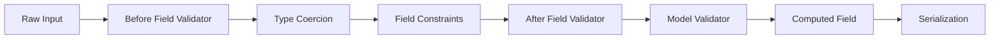

# Pydantic Notes

<div align="center" class="hero">

[](https://www.python.org/)
[](https://docs.pydantic.dev/latest/)
[](https://fastapi.tiangolo.com/)
[](LICENSE)

**A practical, example-driven guide to Pydantic v2.**

Created by [Abdullah Asim](https://github.com/AbdullahAsim07)

</div>

<style>
.hero { animation: fade-up 0.8s ease-out both; }
.hero img { transition: transform 0.25s ease, filter 0.25s ease; }
.hero img:hover { transform: translateY(-4px) scale(1.04); filter: drop-shadow(0 6px 8px rgba(233,32,99,0.25)); }
.lesson-card { animation: fade-up 0.7s ease-out both; }
.lesson-card:nth-child(2n) { animation-delay: 0.12s; }
.lesson-card:nth-child(3n) { animation-delay: 0.24s; }
@keyframes fade-up {
  from { opacity: 0; transform: translateY(14px); }
  to { opacity: 1; transform: translateY(0); }
}
@media (prefers-reduced-motion: reduce) {
  .hero, .lesson-card { animation: none; }
  .hero img { transition: none; }
}
</style>

## About

Pydantic-Notes teaches data validation and serialization through small, focused Python examples. It covers models, constraints, custom validators, computed fields, nested structures, and JSON output.

## Validation Pipeline



## Lessons

| File | Topic | Concepts |
|---|---|---|
| `1.Pydantic.py` | Models and fields | `BaseModel`, `Field`, constraints, defaults |
| `2.field_validator.py` | Field validation | `@field_validator`, `before`, `after` |
| `3.model_validator.py` | Cross-field validation | `@model_validator` |
| `4.compute_validator.py` | Derived values | `@computed_field`, `@property` |
| `4.nested_model.py` | Nested models | Hierarchical `BaseModel` structures |
| `serialization.py` | Serialization | `model_dump()`, `model_dump_json()` |

## File Guide

<div class="lesson-card">

### <a name="pydantic"></a>`1.Pydantic.py` — Models and fields

Introduces `BaseModel`, typed attributes, `Field`, defaults, and constraints. It shows how Pydantic converts compatible input values and rejects invalid data using a clear validation error.

**Key concepts:** required and optional fields, numeric ranges, string limits, default values, and model instances.

</div>

<div class="lesson-card">

### `2.field_validator.py` — Field validation

Demonstrates custom validation for individual fields with `@field_validator`. The `before` mode preprocesses raw input, while `after` mode validates or transforms an already coerced value.

**Key concepts:** `before`, `after`, normalization, `strip`, reusable field validators, and raising `ValueError`.

</div>

<div class="lesson-card">

### `3.model_validator.py` — Cross-field validation

Explains `@model_validator` for rules that involve more than one field. It is useful when a model's valid state depends on relationships between values.

**Key concepts:** `mode="before"`, `mode="after"`, cross-field relationships, conditional validation, and complete `BaseModel` instances.

</div>

<div class="lesson-card">

### `4.compute_validator.py` — Computed fields

Shows how to derive values dynamically with `@computed_field` and `@property`. The result is available like a model attribute and can be included in serialized output.

**Key concepts:** derived properties, getter-only values, and serializing calculated data.

</div>

<div class="lesson-card">

### `4.nested_model.py` — Nested models

Builds hierarchical data with nested `BaseModel` classes. Pydantic validates dictionaries and objects recursively and naturally represents JSON-style structures.

**Key concepts:** nested schemas, lists of models, recursive validation, and structured JSON input.

</div>

<div class="lesson-card">

### `serialization.py` — Serialization

Explains how to export validated models to Python dictionaries or JSON. It distinguishes in-memory data from a portable JSON string and can include or exclude fields as needed.

**Key concepts:** `model_dump()`, `model_dump_json()`, field aliases, and JSON-ready output.

</div>

## Quick Start

```bash
# Clone the repository
git clone https://github.com/AbdullahAsim07/Pydantic-Notes.git
cd Pydantic-Notes

# Create and activate a virtual environment
python -m venv .venv

# Windows
.venv\Scripts\activate

# macOS/Linux
source .venv/bin/activate

# Install dependencies
pip install --upgrade pip
pip install "pydantic[email]"

# Run an example
python 1.Pydantic.py
```

## Example

```python
from typing import Optional

from pydantic import BaseModel, Field, computed_field, model_validator


class Patient(BaseModel):
    name: str = Field(..., max_length=50)
    age: int = Field(..., ge=0, le=120)
    weight_kg: float = Field(..., gt=0)
    height_cm: float = Field(..., gt=0)
    emergency_contact: Optional[str] = Field(None, max_length=15)

    @model_validator(mode="after")
    def require_emergency_contact(self):
        if self.age < 18 and not self.emergency_contact:
            raise ValueError("Minors must provide an emergency contact")
        return self

    @computed_field
    @property
    def bmi(self) -> float:
        return round(self.weight_kg / (self.height_cm / 100) ** 2, 2)


patient = Patient(
    name="Alice",
    age=17,
    weight_kg=60,
    height_cm=165,
    emergency_contact="1234567890",
)

print(patient.bmi)  # 22.04
print(patient.model_dump())
```

## License

Licensed under the [MIT License](LICENSE).

<div align="center">

If this project helped you, consider giving it a ⭐.

</div>

